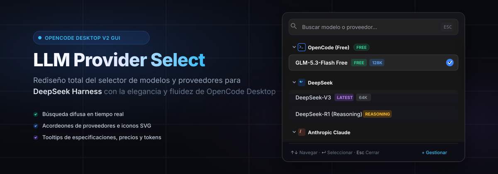
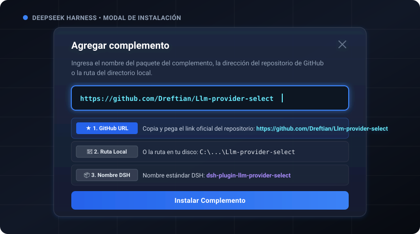
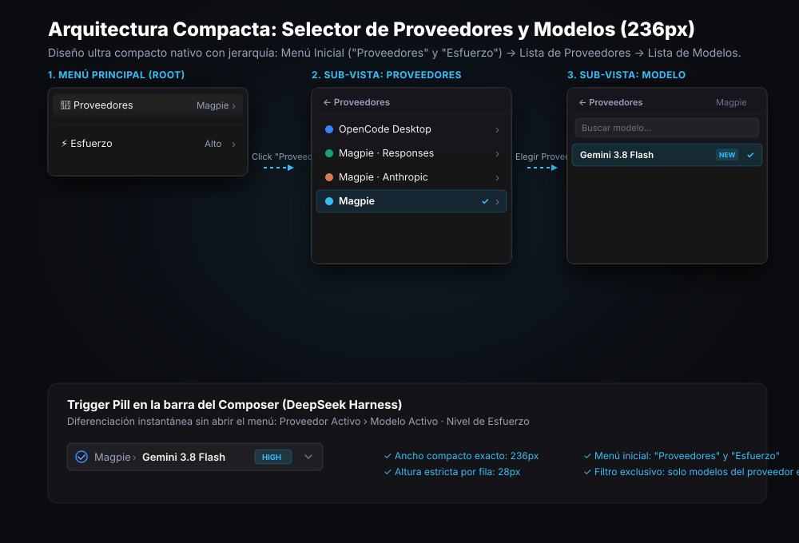

<p align="center">
  
</p>

<p align="center">
  <strong>Transforma por completo el selector de proveedores y modelos en DeepSeek Harness al diseño idéntico de OpenCode Desktop v2.</strong>
</p>

<p align="center">
  <a href="#-cómo-instalar-en-deepseek-harness-interfaz-gráfica"></a>
  <a href="#características"></a>
  <a href="LICENSE"></a>
  <a href="README.md"></a>
</p>

---

## 📥 ¿Cómo instalar en DeepSeek Harness? (Interfaz Gráfica)

Si abriste la ventana modal de **Complementos > + Agregar plugin** en DeepSeek Harness:

<p align="center">
  
</p>

La interfaz de DeepSeek Harness te solicitará:
> *"Ingresa el nombre del paquete del complemento, la dirección del repositorio de GitHub o la ruta del directorio local."*

Copia y pega cualquiera de las siguientes opciones en el campo de texto:

### 🌟 Opción 1: Enlace directo del repositorio de GitHub (Recomendada)
Esta es la opción más sencilla y recomendada. Solo copia y pega la URL oficial:

```text
https://github.com/Dreftian/Llm-provider-select
```

*O si prefieres el formato corto de GitHub:*
```text
Dreftian/Llm-provider-select
```

* **¿Cómo funciona?**: DeepSeek Harness descargará y sincronizará de forma automática la última versión oficial del plugin directamente desde GitHub.

---

### 📁 Opción 2: Ruta del directorio local (Si ya tienes el proyecto en tu PC)
Si ya tienes la carpeta del repositorio descargada o clonada en tu computadora, puedes ingresar la ruta completa a la carpeta:

```text
C:\Users\Dreitz\.gemini\antigravity\scratch\Llm-provider-select
```
*(O la ruta absoluta donde tengas ubicada la carpeta del proyecto en tu disco)*.

* **¿Cómo funciona?**: DeepSeek Harness cargará el complemento en tiempo real directamente desde tus archivos locales, sin necesidad de conexión a internet y permitiéndote realizar modificaciones en vivo.

---

### 📦 Opción 3: Nombre de paquete estándar DSH
Si utilizas el registro de paquetes oficial de DeepSeek Harness o npm:

```text
dsh-plugin-llm-provider-select
```
*(o también el alias `llm-provider-select`)*.

* **¿Cómo funciona?**: Sigue el estándar de nomenclatura oficial de DeepSeek Harness (`dsh-plugin-*`), exactamente igual al ejemplo que muestra la aplicación (`dsh-plugin-whale-pet`).

---

### 🚀 Guía paso a paso para activarlo:
1. Abre **DeepSeek Harness Desktop** (o la interfaz web).
2. En la barra de navegación lateral izquierda, haz clic en **Complementos** (icono de rompecabezas / puzzle).
3. En la esquina superior derecha, presiona el botón **`+ Agregar plugin`**.
4. Pega en la casilla de texto el enlace de GitHub:
   ```text
   https://github.com/Dreftian/Llm-provider-select
   ```
5. Haz clic en el botón azul **Instalar**.
6. ¡Listo! Abre cualquier conversación y haz clic en el selector de modelo en la barra inferior (composer). Se abrirá de inmediato el nuevo popover flotante con diseño de OpenCode Desktop v2.

---

## 🌟 Resumen

**`Llm-provider-select`** (nombre de paquete `dsh-plugin-llm-provider-select`) es un plugin de interfaz para el motor Cordis de **DeepSeek Harness** (`dsh`) diseñado para sustituir por completo el selector nativo de modelos y proveedores.

En lugar de los menús rígidos de 2 niveles por defecto, implementa la estética visual y experiencia de usuario de **[OpenCode Desktop](https://opencode.ai/es)**:
- **Popover Modal Flotante con Glassmorphism**: Panel con desenfoque de fondo (*backdrop-filter: blur*), bordes translúcidos y animación de entrada fluida.
- **Búsqueda Difusa en Tiempo Real**: Filtrado veloz por nombre de modelo, proveedor o capacidades con navegación completa por teclado.
- **Acordeones de Proveedores e Iconos Oficiales SVG**: Secciones plegables con chevrons rotatorios para OpenCode Free, DeepSeek, Anthropic Claude, OpenAI, Google Gemini, Groq, Mistral, Ollama y WorkBuddy AI.
- **Badges Visuales Informativos**: Etiquetas estilizadas de `FREE`, `LATEST` y ventana de contexto (`128K`, `1M`).
- **Tooltip de Especificaciones al Pasar el Cursor**: Tarjeta flotante que muestra tokens de contexto, tokens de salida máximos, precio de entrada/salida y capacidades especiales.

<p align="center">
  
</p>

---

## ⚡ Características Principales

### 1. Botón Trigger Estilo OpenCode
* Sustituye el texto plano por un chip redondeado moderno con borde translúcido.
* Muestra el icono de la marca del proveedor activo (logo de OpenCode, ballena de DeepSeek, chispa de Claude, etc.).
* Badge `FREE` integrado automáticamente para modelos gratuitos (como `OpenCode Glm 5.3 Flash Free`).
* Chevron animado con rotación suave al abrir y cerrar.

### 2. Acordeones Plegables de Proveedores (`ProviderModelSections`)
* Agrupa los modelos de forma limpia y ordenada bajo su proveedor.
* Chevron con rotación de 180° e indicador de cantidad de modelos por categoría.
* Permite colapsar o expandir secciones según tus preferencias.

### 3. Búsqueda Instantánea y Navegación por Teclado
* Enfoque automático al abrir el selector.
* Coincidencia difusa (*fuzzy search*) en tiempo real.
* **Operación total sin ratón**:
  * <kbd>↓</kbd> / <kbd>↑</kbd> para desplazarse entre modelos con auto-scroll integrado.
  * <kbd>Enter</kbd> para seleccionar y confirmar el modelo activo.
  * <kbd>Esc</kbd> para descartar y cerrar el menú.

### 4. Tarjeta Flotante de Especificaciones (`ModelTooltip`)
* Pasa el cursor sobre cualquier modelo o selecciónalo con las flechas para inspeccionar:
  * **Límite de contexto** (ej. 128,000 tokens, 200,000 tokens).
  * **Salida máxima de tokens** (ej. 8,192 tokens).
  * **Tarifas de precios** (*100% Gratuito* o coste por millón de tokens).
  * **Habilidades** (Código, Ejecución de Herramientas, Visión, Razonamiento Profundo).

---

## 🚀 Simulador Interactivo en Vivo

Puedes probar la experiencia completa de OpenCode Desktop inmediatamente sin modificar tus archivos de DeepSeek Harness:

```bash
git clone https://github.com/Dreftian/Llm-provider-select.git
cd Llm-provider-select
npm run start:demo
```
Abre [http://localhost:3000](http://localhost:3000) (o abre directamente el archivo `demo/index.html` en tu navegador favorito).

---

## 📦 Métodos de Instalación Alternativos

### Método A: Instalador Automático por Consola (Scripts incluidos)

#### En Windows (PowerShell):
Ejecuta el script incluido en el repositorio:
```powershell
.\install.ps1
```
O directamente vía web en PowerShell:
```powershell
irm https://raw.githubusercontent.com/Dreftian/Llm-provider-select/main/install.ps1 | iex
```

#### En macOS / Linux (Terminal):
```bash
curl -fsSL https://raw.githubusercontent.com/Dreftian/Llm-provider-select/main/install.sh | bash
```

---

### Método B: Configuración en DeepSeek Harness (`cordis.yml`)

Añade el plugin en tu archivo `~/.dsh/cordis.yml`:

```yaml
plugins:
  - name: 'dsh-plugin-llm-provider-select'
    defaultProvider: 'opencode-free'
    enableFuzzySearch: true
    showPricingBadges: true
```

O mediante el parche de bundle (`cordis.patch.yml`):
```yaml
- insert:
    - id: dsh-plugin-llm-provider-select
      name: 'dsh-plugin-llm-provider-select'
```

---

### Método C: Inyección Directa en DeepSeek Harness Desktop (`client.js`)

Si utilizas la versión empaquetada de DeepSeek Harness Desktop:
1. Copia el archivo `client.js` en tu carpeta de scripts de DeepSeek Harness (`~/.dsh/plugins/` o dentro de los recursos de la aplicación).
2. Reinicia DeepSeek Harness Desktop.

---

## 🛠️ Estructura del Repositorio

```text
Llm-provider-select/
├── assets/
│   ├── banner.svg               # Banner principal en alta resolución
│   ├── dsh-install-guide.svg    # Diagrama visual de la ventana de instalación DSH
│   ├── preview-selector.svg     # Diagrama explicativo de la interfaz
│   └── icons/                   # Iconos vectoriales de marcas (SVG)
├── demo/
│   ├── index.html               # Simulador interactivo en navegador
│   ├── demo.css                 # Estilos OpenCode Desktop
│   └── demo.js                  # Motor de búsqueda y navegación
├── src/
│   ├── index.ts                 # Punto de entrada para el host de Cordis
│   ├── cordis.d.ts              # Tipados de TypeScript
│   ├── css-modules.d.ts         # Declaraciones para módulos CSS
│   └── client/
│       ├── index.ts             # Registro del slot conversation.input.model
│       ├── OpenCodeModelSelect.tsx  # Componente React réplica de OpenCode Desktop
│       ├── OpenCodeModelSelect.module.css
│       ├── ProviderIcons.tsx    # Renderizador de iconos de proveedores
│       ├── ModelTooltip.tsx     # Tarjeta flotante de especificaciones
│       ├── search.ts            # Algoritmo de búsqueda difusa
│       └── types.ts             # Tipos e interfaces de TypeScript
├── dist/                        # Código compilado para producción
├── cordis.patch.yml             # Parche de bundle para DeepSeek Harness
├── install.ps1                  # Instalador automatizado para Windows
├── install.sh                   # Instalador automatizado para Linux/macOS
├── package.json
├── tsconfig.json
├── README.md                    # Documentación en inglés
├── README.es.md                 # Documentación en español
└── LICENSE                      # Licencia MIT
```

---

## 🎨 Proveedores e Iconos Incluidos

| Proveedor | Icono SVG | Modelos Soportados |
|---|:---:|---|
| **OpenCode Free** |  | `GLM-5.3-Flash Free`, `GLM-5.2 · ZCode`, `GLM-5-Turbo` |
| **DeepSeek** |  | `DeepSeek-V4.1-Flash`, `DeepSeek-V4-Pro`, `DeepSeek-V3`, `DeepSeek-R1` |
| **Anthropic** |  | `Claude 3.7 Sonnet (Thinking)`, `Claude 3.5 Haiku` |
| **OpenAI** |  | `GPT-6.1-Sol · Codex`, `GPT-6-Astra`, `GPT-5-Luna` |
| **Google** |  | `Gemini 2.5 Pro`, `Gemini 2.5 Flash` |
| **WorkBuddy AI** |  | `Auto`, `Fast · x0.34`, `Balanced · x0.59`, `Primary · x3.31` |
| **Groq / Mistral / Ollama** |  | Modelos abiertos locales y remotos |

---

## 📄 Licencia

Publicado bajo la **Licencia MIT**. Consulta el archivo [`LICENSE`](LICENSE) para más detalles.

---

<p align="center">
  Desarrollado con dedicación por <a href="https://github.com/Dreftian"><strong>Dreftian</strong></a>
</p>
